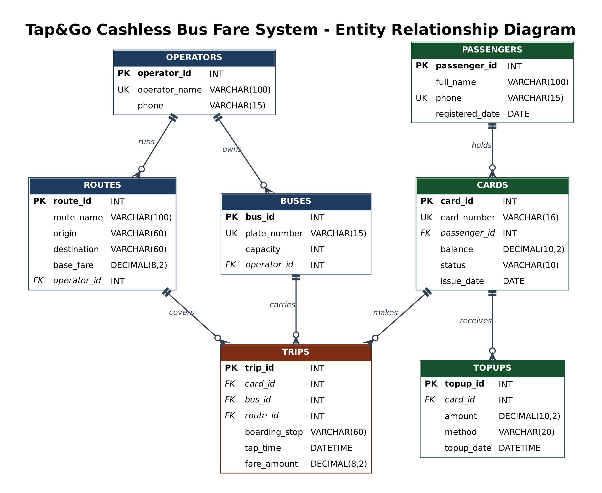

# Tap&Go Cashless Bus Fare System: SQL JOINs and Window Functions

**Course:** SQL - Assignment VI (SQL Window Functions), Université Libre de Kigali (ULK)
**Group:** [Group X]
**DBMS:** MySQL 8.0 or later

> **Data note:** Tap&Go here is a *Tap&Go-style* cashless bus fare system. All records are illustrative sample data created for this project (January to June 2026), not real company data. The findings demonstrate the analytical method rather than the real performance of any operator.

---

## 1. Project Title
**Revenue, route and passenger analysis for a cashless bus fare system in Kigali using SQL JOINs and window functions.**

## 2. Group Members
| No. | Full name | Student ID | GitHub username |
|---|---|---|---|
| 1 | [Name] | [ID] | [username] |
| 2 | [Name] | [ID] | [username] |
| 3 | [Name] | [ID] | [username] |
| 4 | [Name] | [ID] | [username] |

## 3. Business Background
Tap&Go is a cashless fare payment system for urban buses in Kigali, Rwanda. Passengers load money onto a prepaid card through mobile money (MTN MoMo, Airtel Money) or agents, then tap the card on a validator when boarding. Several bus operators run routes across the city, and every tap creates a transaction record. The system must track passengers, cards, top-ups, buses, routes, trips and operator earnings.

## 4. Problem Statement
Data on cards, top-ups, trips and operator earnings is scattered across separate logs and operator reports. Management cannot easily see which routes and operators earn the most, when demand changes, how passengers use their cards, or which buses and cards sit idle. Operator settlement is slow and error-prone. A relational database with SQL analysis centralises this data and supports accurate reporting and planning.

## 5. Project Objectives
| # | Objective | SQL features | Query file |
|---|---|---|---|
| 1 | Rank routes by revenue, and passengers within each operator | `ROW_NUMBER`, `RANK`, `DENSE_RANK`, `PERCENT_RANK` | `06_ranking_functions.sql` |
| 2 | Calculate running and cumulative monthly revenue | `SUM() OVER()` with ROWS and RANGE frames | `07_aggregate_window_functions.sql` |
| 3 | Compare monthly revenue with the previous and next month | `LAG`, `LEAD` | `08_navigation_functions.sql` |
| 4 | Segment passengers into four spending groups | `NTILE(4)`, `CUME_DIST` | `09_distribution_functions.sql` |
| 5 | Calculate three-month moving averages | `AVG() OVER()` with a ROWS frame | `07_aggregate_window_functions.sql` |

Objective 1 was refined from "top five routes per operator" to a system-wide route ranking plus a per-operator passenger ranking, because every operator in the sample data runs at most two routes.

## 6. Database Schema and Table Descriptions
Database name: `tapgo_db` (7 tables).

| Table | Description | Primary key | Foreign keys | Rows |
|---|---|---|---|---|
| `operators` | Bus companies | `operator_id` | - | 5 |
| `routes` | Routes with origin, destination and base fare | `route_id` | `operator_id` | 7 |
| `buses` | Fleet of each operator | `bus_id` | `operator_id` | 8 |
| `passengers` | Registered passengers | `passenger_id` | - | 9 |
| `cards` | Prepaid cards with balance and status | `card_id` | `passenger_id` | 9 |
| `topups` | Money loaded onto cards | `topup_id` | `card_id` | 13 |
| `trips` | Every tap with the fare charged | `trip_id` | `card_id`, `bus_id`, `route_id` | 33 |

**Relationships:** one operator has many routes and buses; one passenger has many cards; one card has many top-ups and trips; one bus and one route each have many trips.

**Constraints:** unique operator name, plate number, passenger phone and card number; CHECK constraints on fares, amounts, capacity, balance, card status and top-up method; foreign keys on all child tables (see `database/03_constraints.sql`).

**Sample data:** trips cover January to June 2026. A few unmatched records (route 7, buses 7 and 8, passenger and card 9, operators 4 and 5) were added so the LEFT, RIGHT and FULL OUTER joins have meaningful results.

## 7. ER Diagram


## 8. JOIN Implementations
| JOIN | Query file | Business question | Result | Screenshot |
|---|---|---|---|---|
| INNER | `queries/01_inner_join.sql` | Which passenger, route and operator are behind each tap? | First 10 of 33 trips, all fully matched | [view](screenshots/joins/01_inner_join.png) |
| LEFT | `queries/02_left_join.sql` | Which cards were never used for a trip? | 1 card: TG00000000000009 (Kamanzi Joel, balance 1,000) | [view](screenshots/joins/02_left_join.png) |
| RIGHT | `queries/03_right_join.sql` | Which buses never carried a trip? | 2 buses: RAD303G (Royal Express) and RAE401H (Volcano Transport) | [view](screenshots/joins/03_right_join.png) |
| FULL OUTER (emulated) | `queries/04_full_outer_join.sql` | Which operators have routes but no buses, or buses but no routes? | City Express has a route but no buses; Volcano Transport has a bus but no routes | [view](screenshots/joins/04_full_outer_join.png) |
| SELF | `queries/05_self_join.sql` | Which routes start from the same origin, and how do their fares compare? | 6 route pairs (2 within the same operator, 4 between competing operators) | [view](screenshots/joins/05_self_join.png) |

MySQL has no `FULL OUTER JOIN` keyword, so it is emulated with `LEFT JOIN ... UNION ... RIGHT JOIN`.

## 9. Window Function Implementations
| Group | Query file | Functions | Screenshots |
|---|---|---|---|
| A. Ranking | `queries/06_ranking_functions.sql` | `ROW_NUMBER`, `RANK`, `DENSE_RANK`, `PERCENT_RANK` | [A1](screenshots/window_functions/A1_route_ranking.png), [A2](screenshots/window_functions/A2_top3_passengers_per_operator.png), [A3](screenshots/window_functions/A3_bus_performance_ranking.png), [A4](screenshots/window_functions/A4_top_operator.png) |
| B. Aggregate | `queries/07_aggregate_window_functions.sql` | `SUM`, `AVG`, `MIN`, `MAX`, `COUNT` with `PARTITION BY`, `ROWS` and `RANGE` | [B1](screenshots/window_functions/B1_running_and_cumulative_revenue.png), [B2](screenshots/window_functions/B2_operator_averages_vs_overall.png), [B3](screenshots/window_functions/B3_moving_average.png), [B4](screenshots/window_functions/B4_rows_vs_range.png) |
| C. Navigation | `queries/08_navigation_functions.sql` | `LAG`, `LEAD` | [C1](screenshots/window_functions/C1_monthly_revenue_lag_lead.png), [C2](screenshots/window_functions/C2_consecutive_trips_per_card.png), [C3](screenshots/window_functions/C3_upcoming_topups.png) |
| D. Distribution | `queries/09_distribution_functions.sql` | `NTILE(4)`, `CUME_DIST` | [D1](screenshots/window_functions/D1_passenger_spending_quartiles.png), [D2](screenshots/window_functions/D2_bus_performance_quartiles.png), [D3](screenshots/window_functions/D3_route_cume_dist.png), [D4](screenshots/window_functions/D4_card_trip_frequency.png) |

**Business terms used:** product = route, customer = passenger (card), region/branch = bus operator, employee = bus, sales = fare amount, payment = top-up.

Core expressions from each group (the full queries are in the `queries` folder):

```sql
-- A. Ranking
ROW_NUMBER()   OVER (ORDER BY revenue DESC, route_id) AS row_num,
RANK()         OVER (ORDER BY revenue DESC)           AS rnk,
DENSE_RANK()   OVER (ORDER BY revenue DESC)           AS dense_rnk,
PERCENT_RANK() OVER (ORDER BY revenue DESC)           AS pct_rank

-- B. Aggregate (ROWS frame and RANGE frame)
SUM(revenue) OVER (ORDER BY sales_month ROWS BETWEEN UNBOUNDED PRECEDING AND CURRENT ROW) AS running_revenue,
AVG(revenue) OVER (ORDER BY sales_month ROWS BETWEEN 2 PRECEDING AND CURRENT ROW)         AS moving_avg_3m,
SUM(t.fare_amount) OVER (ORDER BY t.fare_amount RANGE BETWEEN UNBOUNDED PRECEDING AND CURRENT ROW) AS running_range

-- C. Navigation
LAG(revenue)  OVER (ORDER BY sales_month) AS prev_month_revenue,
LEAD(revenue) OVER (ORDER BY sales_month) AS next_month_revenue

-- D. Distribution
NTILE(4)    OVER (ORDER BY total_spent DESC, card_id) AS spending_group,
CUME_DIST() OVER (ORDER BY revenue)                   AS cume_dist_asc
```

**ROW_NUMBER vs RANK vs DENSE_RANK** (two routes tied at revenue 2,100):

| Function | Tied rows get | After the tie | Result in query A1 |
|---|---|---|---|
| `ROW_NUMBER` | different numbers | continues 1,2,3... | 2 and 3 |
| `RANK` | the same rank | skips numbers | 2, 2, then 4 |
| `DENSE_RANK` | the same rank | no skipping | 2, 2, then 3 |

**ROWS vs RANGE:** `ROWS` counts physical rows, while `RANGE` includes every row with the same `ORDER BY` value. Query B4 shows this on tied fares: with ROWS the running total grows one trip at a time (350, 700, ... 1,750), while with RANGE all five 350-fare trips show 1,750.

## 10. Key Analytical Findings

### 10.1 Descriptive analysis: what happened?
- **Overall:** 33 trips produced 12,450 in fare revenue between January and June 2026, an average of 377.27 per trip.
- **Monthly revenue:**

| Month | Trips | Revenue | Change vs previous | 3-month moving average |
|---|---|---|---|---|
| 2026-01 | 5 | 1,900 | - | 1,900.00 |
| 2026-02 | 6 | 2,200 | +15.79% | 2,050.00 |
| 2026-03 | 6 | 2,400 | +9.09% | 2,166.67 |
| 2026-04 | 6 | 2,200 | -8.33% | 2,266.67 |
| 2026-05 | 5 | 1,950 | -11.36% | 2,183.33 |
| 2026-06 | 5 | 1,800 | -7.69% | 1,983.33 |

  Cumulative revenue reached 6,500 (52.21% of the total) by March.
- **Routes:** Nyabugogo - Kimironko leads with 3,200 (25.70%). Downtown - Kacyiru and Downtown - Kicukiro tie at 2,100, followed by Nyabugogo - Kanombe (1,800), Nyabugogo - Remera (1,750) and Remera - Kabuga (1,500). The new route Downtown - Kimironko has no trips. The top three routes (43% of routes) bring in 59.44% of revenue.
- **Operators:**

| Operator | Trips | Revenue | Share | Average fare |
|---|---|---|---|---|
| RFTC | 13 | 4,950 | 39.76% | 380.77 |
| Kigali Bus Services | 13 | 4,200 | 33.73% | 323.08 |
| Royal Express | 7 | 3,300 | 26.51% | 471.43 |
| City Express, Volcano Transport | 0 | 0 | 0% | - |

- **Passengers:** the top spending group (Uwase Aline, Niyonzima Eric, Habimana Jean) produces 54.22% of revenue; the bottom group produces 5.62%. Kamanzi Joel's card was never used. Seven of nine passengers (77.78%) made four trips or fewer, and the most active passenger made eight.
- **Top-ups:** top-up activity fell from 4 top-ups (14,000) in January to 2 (4,000) in May and none in June. Only cards 1, 2 and 5 were topped up more than once, with gaps of 30 to 90 days.
- **Idle resources:** two buses (RAD303G, RAE401H) recorded no trips, City Express has no buses and Volcano Transport has no routes.

### 10.2 Diagnostic analysis: why did it happen?
These are possible explanations, to be confirmed with real operational data.
- **Revenue decline after March:** the fall in trips and revenue follows a sharp fall in top-ups (from 12,000 in February to 5,000 in March and 4,000 in May). Passengers who stop reloading cards stop tapping, so the cause may lie in the top-up experience, in competing payment methods such as cash, or in seasonal travel patterns.
- **Route concentration:** Nyabugogo - Kimironko leads because it has a high fare (400) and all of its eight trips come from one very frequent passenger. Each route in the sample is served by only one or two cards, so rankings are driven by a few passengers rather than broad demand.
- **Tie between two routes:** Downtown - Kacyiru (7 trips at 300) and Downtown - Kicukiro (6 trips at 350) earn the same 2,100 through different fare and volume mixes.
- **Operator differences:** RFTC leads through volume and mid-range fares. Royal Express has the highest average fare but the fewest trips. Kigali Bus Services has the lowest average fare (routes priced at 300 to 350).
- **Idle assets:** the unused buses and incomplete operators point to setup gaps, such as buses not assigned to routes or validators not registered. The unused card suggests passengers who register and load money but never start riding.
- **Low trip frequency:** most passengers ride occasionally, and even the most active one has gaps of 7 to 33 days between trips.

### 10.3 Prescriptive analysis: what should be done next?
1. **Reverse the decline:** use the LAG-based gap query (C2) to find passengers with no trip in the last 30 days and send reminders, and offer top-up bonuses through mobile money and agents.
2. **Use idle capacity:** reassign buses RAD303G and RAE401H to the busiest routes (Nyabugogo - Kimironko and the Downtown routes) or inspect them for faults and unregistered validators.
3. **Complete operator setup:** assign buses to City Express and routes to Volcano Transport before the next settlement cycle.
4. **Protect and grow the customer base:** reward the high-value group with loyalty offers, give first-ride or top-up incentives to the low-value group, and follow up on the unused card.
5. **Reduce dependence on a few passengers:** promote the lower-earning routes (Remera, Kanombe, Kabuga) to broaden demand.
6. **Improve data and reporting:** run the window-function queries monthly for operator settlement, record validator and payment-channel details, reconcile card balances against top-ups and fares, and repeat the analysis on at least 12 months of real data to confirm seasonality.

**Limitations:** the dataset is small and illustrative, so findings show the method rather than real performance. Comparing top-up totals with fares spent was not part of the required queries and is left as future work.

## 11. Instructions for Executing the SQL Scripts
**Requirements:** MySQL 8.0.16 or later (needed for window functions, CTEs and CHECK constraints) and MySQL Workbench or the `mysql` command-line client.

1. Clone the repository and open a terminal in the repository folder.
2. Start the MySQL client: `mysql -u root -p`
3. Run the database scripts **in order**:
```sql
SOURCE database/01_create_tables.sql;
SOURCE database/02_insert_data.sql;
SOURCE database/03_constraints.sql;
```
4. Run the query scripts in any order:
```sql
SOURCE queries/01_inner_join.sql;
SOURCE queries/02_left_join.sql;
SOURCE queries/03_right_join.sql;
SOURCE queries/04_full_outer_join.sql;
SOURCE queries/05_self_join.sql;
SOURCE queries/06_ranking_functions.sql;
SOURCE queries/07_aggregate_window_functions.sql;
SOURCE queries/08_navigation_functions.sql;
SOURCE queries/09_distribution_functions.sql;
```
In MySQL Workbench, use **File > Open SQL Script**, then run each script with the lightning-bolt button. The window-function files contain several queries, so run them one at a time (select a query, then press Ctrl+Enter).

## 12. References
Oracle Corporation. (n.d.). *MySQL 8.0 reference manual: Window functions*. MySQL. https://dev.mysql.com/doc/refman/8.0/en/window-functions.html

Oracle Corporation. (n.d.). *MySQL 8.0 reference manual: Window function descriptions*. MySQL. https://dev.mysql.com/doc/refman/8.0/en/window-function-descriptions.html

Oracle Corporation. (n.d.). *MySQL 8.0 reference manual: Window function frame specification*. MySQL. https://dev.mysql.com/doc/refman/8.0/en/window-functions-frames.html

Oracle Corporation. (n.d.). *MySQL 8.0 reference manual: Named windows*. MySQL. https://dev.mysql.com/doc/refman/8.0/en/window-functions-named-windows.html

Oracle Corporation. (n.d.). *MySQL 8.0 reference manual: JOIN clause*. MySQL. https://dev.mysql.com/doc/refman/8.0/en/join.html

Oracle Corporation. (n.d.). *MySQL 8.0 reference manual: WITH (common table expressions)*. MySQL. https://dev.mysql.com/doc/refman/8.0/en/with.html

Graphviz. (n.d.). *Graphviz documentation*. https://graphviz.org/documentation/

Université Libre de Kigali. (2026). *Assignment VI: SQL window functions* [Assignment brief].

<!-- Add any further books, tutorials or videos the group actually used, in APA 7th edition style. -->

## 13. Academic Integrity Statement
All sources were properly cited.

The group wrote, ran and checked the SQL scripts on its own MySQL installation, and the screenshots show real query execution.

**Use of AI assistance:** an AI assistant, Claude (Anthropic, 2026), was used to help draft the SQL queries, the documentation structure and the explanations. The group reviewed, executed and verified the results. *(Group members: confirm that this disclosure is accurate and complies with the course's AI policy before submission.)*

Signed: [Member 1] | [Member 2] | [Member 3] | [Member 4]